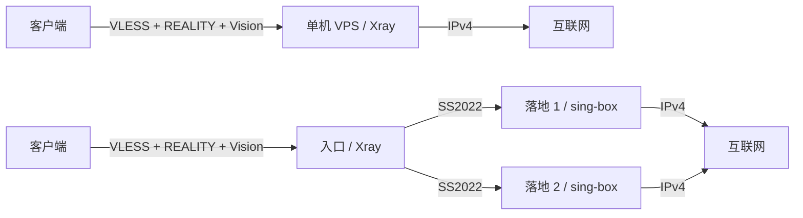

# Reality Proxy Kit：首版设计与发布清单

说明：本文中的“原项目/当前项目”指设计阶段的私有参考项目，其生产资料未进入本仓库。历史来源版本仅用于追溯，当前候选以 manifests 中经复核的固定版本为准。
- 设计日期：2026-10-29（Asia/Shanghai）。
- 设计依据：本次 Q1–Q26 讨论及用户确认；当前项目源码、已保存的链式教程和上游官方资料。
- 仓库名称：reality-proxy-kit；skill 名称：deploy-reality-proxy。创建仓库前检查名称可用性。
- 首次可安装发行：v0.1.0，发布页标记为 Pre-release。
- 状态：**设计决定已逐项确认；本文不是实现完成或测试通过的声明。** 所有实施和验收复选框初始均未完成。
- 本文用于最终整体复核与后续实施；不授权根据历史教程直接操作现有生产机器。

## 1. 产品目标与首版范围

面向已经拥有 VPS 和 SSH 权限的个人或亲友使用场景。使用者通过 Codex 调用 skill，由可独立运行的部署 CLI 完成检查、配置生成、安装、验证和维护。

公开交付物为 skill、部署 CLI、配置模板、验证用例、兼容内核发行包及文档。新建干净公开仓库，按组件抽取可复用代码；当前生产仓库不直接改为公开。

### 1.1 首版包含

| 范围 | 已确认的边界 |
| --- | --- |
| 单机 | 客户端通过 VLESS + REALITY + Vision 连接一台 VPS，由该 VPS 出网 |
| 链式 | 客户端连接一台入口，入口通过 SS2022 连接指定落地；支持一入口、一个或多个落地 |
| 核心独立 | 不安装面板也能部署、管理基础账号和导出客户端配置 |
| 面板扩展 | 可选安装 3x-ui，复用其管理员界面及动态订阅能力 |
| REALITY target | 支持经过检查的远端 TLS 网站，以及 VPS 本机真实 TLS 网站 |
| 网站教程 | 域名选购、DNS、证书、静态网站部署、续期、已有 TLS 网站接入和验证 |
| 账户 | 创建、禁用、删除、轮换凭据、按账号授权路线 |
| 运维 | 安装、诊断、备份恢复、增删或替换落地、入口换机、单机转链式、纯核心转面板 |
| 客户端 | Shadowrocket、Mihomo 为主要使用端；Xray 客户端用于自动化协议验证 |
| 发行 | 固定依赖与校验值；提供审核后的兼容内核预编译包和对应源码 |
| 可扩展性 | 第一跳和第二跳分别保留扩展接口；首版各只实现一种已确认方案 |

### 1.2 不列入首版承诺

- 多入口集群、自动选路、自动切换落地、三跳以上链路。
- 链式入口同时提供直出节点，以及链路故障后回退入口直出。
- 独立用户登录门户、自助注册、计费系统、流量额度或限速等新开发能力。
- 纯核心模式的动态订阅服务器；纯核心交付本地导入资料。
- 浏览器测速平台、IP 质量平台、完整监控平台、完整访问明细及专用流量观测补丁。
- CPA、API 中转平台、WordPress、数据库网站或任意后端应用的一键部署。
- 内核或面板自动升级、自动选择最新协议、任意上游版本适配。
- 任意已有代理或面板的自动接管、面板模式反向迁回纯核心的通用转换。
- NAT VPS、IPv6-only VPS、IPv6 业务出口、其他发行版或 CPU 架构、Docker 部署。
- 全设备 DNS/WebRTC 防泄漏、所有客户端 GUI、所有游戏或 QUIC 应用兼容的保证。
- 云备份托管、密钥找回服务、带宽或不中断维护的保证。

3x-ui 自带的其他功能可以保留，但不因此扩大 skill 首版的自动化与验收范围。

## 2. 支持矩阵与准备条件

| 项目 | 首版目标 |
| --- | --- |
| VPS 系统 | Ubuntu 24.04，Linux amd64 |
| 初次安装 | 空白候选机；后续维护允许操作本项目已登记的机器 |
| 权限 | 可用 SSH；root 或免交互 sudo |
| 机器身份 | 经核对的 SSH host key、机器标识、实际网卡、地址及端口 |
| 网络 | 每台机器具有公网 IPv4；客户端到入口可选 IPv6 |
| 最终业务出口 | IPv4 |
| 部署形式 | 原生 systemd 服务 |
| 控制端 | macOS、Linux；Windows 通过 WSL |
| AI 工具 | 首版完整验证 Codex；CLI 不依赖 Codex 专用工具 |
| 域名 | 远端 target 的纯代理部署不要求自有域名；公开网站或动态订阅需要域名与 HTTPS |
| 控制端依赖 | 在公开清单中固定支持的 Python 和部署依赖版本；不能依赖作者已有私有工具 |

服务器购买不纳入自动化。域名教程说明选购及配置步骤，不自动代用户购买或接受付费条款。DNS 配置不绑定某一个供应商。

其他 AI 工具、原生 Windows 等未验证环境必须标明未验证，不能仅凭能读取 SKILL.md 就列入正式支持。

## 3. 总体架构

### 3.1 数据链路



每个客户端节点表示一条明确路线。入口和落地使用稳定机器编号；供应商、IP 和显示名称不是身份。

链式路线失败时连接失败；未知、禁用、未授权的路线被阻断。入口不能把这些流量送往自身直出或其他落地。服务器自身更新、证书等管理流量与用户代理流量分别处理。

### 3.2 管理与配置来源

| 模式 | 配置与账号来源 | 操作方式 | 用户交付 |
| --- | --- | --- | --- |
| 纯核心 | 部署工具维护的持久状态；运行配置由该状态生成 | CLI | URI、二维码、客户端配置文件 |
| 面板 | 3x-ui 的账号、代理配置及相关持久状态 | 原生面板或经面板接口操作的 CLI | 本地导出及动态订阅 |

- 每个实例只允许一个配置来源；禁止 CLI 与面板分别维护两份互相覆盖的账号状态。
- 面板模式下，控制端仍管理机器清单、版本和部署记录；代理账号与路由的变更必须通过该模式的适配层。
- 纯核心转面板是显式接管流程：备份、导入身份与路线、候选验证、切换管理归属、验收和失败恢复。
- 接管不能通过重新初始化密钥完成，不能保留两个持续写配置的后台。
- 纯核心持久状态的具体存储格式、事务和修订号机制在实施时确定；必须满足唯一来源、可校验、可备份和防止并发覆盖的要求。

### 3.3 组件职责

| 组件 | 职责 |
| --- | --- |
| skill | 收集需求、识别模式、调用 CLI、解释计划和结果、处理已定义的异常 |
| 通用部署层 | 清单校验、SSH 与机器身份检查、安装、配置验证、服务管理和恢复 |
| 第一跳实现 | VLESS/REALITY/Vision 入站、身份映射、客户端导出、兼容验证 |
| 第二跳实现 | SS2022 两端配置、密钥、监听需求、恢复及协议验收 |
| 纯核心管理实现 | 基础账号与路线的持久状态和配置生成 |
| 面板管理实现 | 通过 3x-ui 管理账号、路由和原生订阅，不另造完整面板 |
| 订阅适配 | 通用 URI 指纹清理、各格式授权过滤及必要的格式兼容处理 |
| 网站/TLS 实现 | 静态站、证书、续期、回落或按 SNI 分流 |
| 验证与诊断 | 行为验证、失败定位、脱敏报告 |
| 备份恢复 | 按管理模式保存并恢复必要身份和状态 |

现项目的订阅适配读取门户桥接服务，备份也要求门户及测速状态。抽取时应拆出必要的面板桥接和模式化恢复清单，不能只删除门户目录后宣称解耦完成。

## 4. REALITY target、网站和公开入口

### 4.1 两类 target

**远端 target：**不要求用户自有域名，但仍需有效 target/SNI。由目标 VPS 检查候选站点的 TLS 行为、证书名称和可达性；不把某个示例域名当作永久适用默认值。

**本机 target：**用户拥有域名，在 VPS 上部署真实 TLS 网站；target 指向专用回环监听，不指向自身公网 443 或解析回入口的域名，避免回环。

网站支持中性静态模板、用户已有静态站及已有 TLS 网站接入指导。网站内容与代理管理后台分离；部署本机网站不要求同时安装面板。

切换 target/SNI 是明确的配置变更。安装网站或面板不能静默更改已有客户端所依赖的 SNI。

### 4.2 公网 443 的实现方案（待实现与验证）

以下是依据固定源码和官方文档得到的实现方案，尚不代表新公开版已经实测。

| 组合 | 公网 TCP 443 的监听者 | 内部路径 |
| --- | --- | --- |
| 远端 target，无公开网站/订阅 | Xray | REALITY 使用远端 target |
| 本机 target | Xray | 普通 TLS 回落到回环 Nginx TLS 服务 |
| 远端 target，同时公开网站/订阅 | Nginx stream | 按 SNI 将网站流量送往本机 TLS 服务，将 REALITY 流量送往回环 Xray |

- 远端模式的公开网站域名与 REALITY serverNames 必须不重叠；同一个 SNI 不能靠 stream 区分网页与已认证 REALITY。
- Nginx stream 透明转发 TLS，不在这一层终止 REALITY。
- 后端只监听回环，必要时使用 PROXY protocol 传递真实来源。
- Xray 接收入站 PROXY 与向 target 发送 PROXY 是不同设置；普通远端 TLS target 使用 xver=0。
- 本机 target 仅在对应 TLS 后端配置匹配时发送 PROXY。
- 检查 Nginx 所需模块、内部端口可用性、未知 SNI 处理及真实来源恢复。
- 不因使用 TCP 443 而宣称支持网站 HTTP/3。

### 4.3 管理、网站与订阅的访问边界

- 管理后台默认仅经 SSH 隧道访问，使用独立回环入口。
- 公开网站只反代允许公开的站点和订阅路径；不能照搬现项目公开管理路由。
- 仅让 3x-ui 监听回环，并不足以证明管理后台未公开；还须验证所有公开反代入口。
- 面板可以先通过 SSH 使用；动态订阅在域名与 HTTPS 准备完成后公开。
- 初始证书签发与续期必须有可运行的路径；HTTP-01 所需 80 端口及 DNS 条件进入预检。
- 既有 TLS 网站的接入是明确配置步骤，不自动接管任意已有应用或端口。

## 5. 账号、授权、客户端与网络行为

### 5.1 稳定身份与授权

- 分开保存账户身份、协议凭据、订阅令牌、机器身份和路线身份。
- 更换供应商、地址或名称不重建身份；路线编号不复用给另一条路线。
- 账户可以创建、禁用、删除、轮换凭据，并获得明确的路线授权。
- 订阅只发布获准路线；服务端必须同时拒绝未授权路线，不能只依赖订阅隐藏节点。
- 未来替换协议保留逻辑身份，不保证不同协议复用同一种凭据。

### 5.2 维护和撤权语义

沿用教程允许保存配置后重启 Xray 的边界，不承诺所有维护无中断。

原教程未定义禁用、删除和撤权对存量 TCP/UDP 会话的行为。实现时对固定版本验证并记录：

1. 禁用或撤权后必须阻止新的未授权连接。
2. 明确已有连接是否继续、何时结束及相关操作的影响范围。
3. 需要立即切断时，提供影响范围明确的处理方式；不能未经验证宣称只影响指定用户。
4. 维护计划展示可能的重启和连接中断，先验证候选配置并准备恢复。

不额外开发额度、到期、限速或定向踢线系统；原生面板其他能力不等于 skill 对它们作出首版承诺。

### 5.3 客户端输出与指纹兼容

- 主要使用端：Shadowrocket、Mihomo；Xray 用于自动化协议验证。
- 纯核心生成本地导入资料；面板模式复用原生通用 URI、Mihomo YAML 和 Xray JSON 订阅。
- 通用订阅、VLESS URI 和二维码不得指定 fp/fingerprint，包括空值或隐含默认值。
- 专用 Mihomo/Xray JSON 按各自格式处理，不能把通用 URI 的约束机械套到所有字段。
- 保留服务端旧 X25519 兼容方案。网页沿用 Chrome140 / Safari26_3 的推荐约定，推荐不写回通用导出。
- 不承诺任意旧客户端可用，不把旧 X25519 兼容解释成获得现代密钥交换能力。
- 节点订阅和客户端分流配置分开维护。只改节点或服务端兼容，不要求重新导入分流配置。
- 兼容表记录客户端、核心版本、测试环境和实测范围；Xray/uTLS 模拟不能代替 Shadowrocket 真机验收。
- 完整分流规则包不是核心必装组件。

### 5.4 DNS、IPv4/IPv6、UDP与私网

- IPv6 入口与 IPv6 出口是不同能力；首版可选双栈入口，业务出口采用 IPv4。
- 服务端收到域名目标时，由最终出口解析：单机在本机，链式在落地；DNS 上游可配置。
- 客户端已解析并传来 IP 时，不能声称该域名由落地解析。
- IPv6 字面目标应有明确处理，不能偶然绕过 IPv4 出口约定。
- 支持 TCP/UDP 代理基础行为；隧道内 UDP 与公网入口的 TCP 监听不是同一层协议。
- 代理用户不能访问 VPS 的私网、回环等禁止目的；域名解析后也执行相应检查。
- 本机 TLS target、管理接口等明确的内部组件通信单独处理，不把它们开放为用户代理目的。
- 不继承原项目为 NAT 测速设置的特殊放行规则。

## 6. 协议扩展与内核发行

### 6.1 第一跳和第二跳分别扩展

| 扩展位置 | 首版 | 新增实现的最低交付 |
| --- | --- | --- |
| 第一跳接入方案 | VLESS + REALITY + Vision | 配置、认证/凭据、客户端导出、兼容和迁移验证 |
| 第二跳连接 | SS2022 | 两端配置、凭据、监听/防火墙需求、备份恢复和验收 |

不先开发任意动态插件框架。新增协议先实现、审查、验证，再加入支持列表；已部署实例继续原方案，由管理员明确迁移。

第二跳更换通常可以保持客户端入口配置；第一跳更换可能需要客户端支持、刷新订阅或重新导入，不能承诺透明切换。

### 6.2 固定依赖和兼容内核

- 从审查过的固定版本起步；公开版最终版本、工具链和 SHA-256 写入独立发行清单。
- 公开清单不是生产部署清单的复制品；不继承生产地址、部署时间或额外功能标记。
- 默认使用项目发布的已验收兼容内核；同时提供源码构建路径。
- 3x-ui 官方包中的内核不能覆盖兼容内核；安装与后续维护均核对实际运行程序。
- 检查磁盘产物、进程对应二进制、版本、兼容开关和实际连接结果。
- 首版构建只包含所需 REALITY 兼容修改，不默认携带现生产的 SS2022 专用流量观测扩展。
- 记录上游提交、工具链、补丁输入、产物哈希、构建命令及验证结果。
- 无匹配审核产物时停止；不临时换官方内核、跳过哈希或放宽认证来完成安装。
- 发布前复查所选版本的安全通告与适用修复；升级能力另行设计。
- 系统安全更新不因保留兼容补丁而被整体停用。

## 7. 部署、维护与迁移流程

### 7.1 首次部署

1. 识别拓扑、管理模式、target 类型、网络及可选网站/订阅需求。
2. 读取并校验私有机器清单；核对 SSH 信任、机器身份、权限、系统、端口、资源和网络条件。
3. 检测已有服务及冲突；对未登记的既有代理停止并说明原因。
4. 生成独立密钥、账户和稳定路线身份，保存为私有状态。
5. 离线生成候选配置和部署计划，展示目标机器、服务、开放端口和重启影响。
6. 在已授权范围执行；链式先准备落地，再准备入口。
7. 验证配置和服务、实际内核、认证、权限、出口、TCP/UDP及故障行为。
8. 交付客户端资料、维护入口和加密恢复包；输出明确的成功项、失败项及未验证项。

生成、计划、执行和验收分开。已经授权的任务无需为每条普通命令重复询问；操作不得扩展到未指定机器、购买、其他服务或本机活动代理切换。

失败时保留诊断和必要状态，执行已定义的恢复步骤。文件恢复不等于系统包、防火墙、证书和数据库的完整事务回滚；不能通过反复擦除重装掩盖失败。

### 7.2 日常维护

- 账户创建、禁用、删除、轮换、路线授权。
- 新增、禁用、移除或替换落地；服务端规则和订阅保持一致。
- 网站更新与证书维护不隐含代理身份或内核替换。
- 检测配置漂移，避免对未知状态直接覆盖。
- 修改前准备相应备份，修改后验证受影响路线及其他路线仍正常。
- 面板手动修改后需要更新备份；旧部署恢复包不能被描述为最新状态。

### 7.3 单机转链式

- 原 VPS 成为入口，新增落地先独立安装验收。
- 保留账户及入口密钥；新增链式路线，不静默把旧直出路线改成另一个含义。
- 明确客户端更新、旧直出路线停用和切换步骤。
- 订阅用户刷新节点；纯核心用户导入新的对应节点资料。
- 准备恢复路径并验证链路失败不回退直出；不承诺零中断。

### 7.4 纯核心转面板

- 校验核心状态并备份；在候选状态导入账户、凭据、路线及授权。
- 验证客户端身份、出口和权限保持预期。
- 显式移交配置权威，停用旧的持续写入路径。
- 验证面板和 CLI 均通过面板模式工作；失败时恢复已知状态。
- 不通过重新生成账户/订阅身份实现所谓接管。

### 7.5 换机

- 入口换机：在空白候选恢复必要状态，验证后明确切换 DNS/入口和落地来源规则。
- 入口 IP 或客户端节点参数变化时，需要刷新订阅或更新本地配置。
- 落地优先按控制端清单重建；保留路线身份，明确调整地址与来源限制。
- 活跃数据库不能被旧备份自动覆盖；存在新数据时单独评估恢复。

## 8. 备份、凭据与诊断

### 8.1 备份契约

首次部署后生成加密恢复包；部署工具执行换机、接管和拓扑调整前更新备份；同时提供手动备份。

| 资料 | 保存方式 |
| --- | --- |
| 机器/拓扑清单、账户和路线身份、协议凭据 | 按模式进入加密恢复包 |
| 面板模式业务状态 | 包含必要面板数据库与相关状态 |
| 证书和静态网站 | 按恢复需求保存；证书允许重签，切换前验收可能需要迁移证书 |
| 解密密钥 | 使用者分开保管，不放入被加密目录或同一归档 |
| SSH/DNS 账户访问权 | 使用者另外保管；源码或代理恢复包不替代这些权限 |
| 日志与观测历史 | 不作为恢复代理的必需状态 |

- 恢复包下载并保存到控制端，不只留在待恢复的 VPS。
- 采用经过验证的认证加密实现；错误密钥、篡改、截断和不兼容模式应拒绝恢复。
- 加密归档不等于运行时配置和在线数据库已加密；原始凭据仍需正确的文件权限和输出控制。
- 备份包括格式版本、管理模式、协议类型、所需版本和完整性信息。
- 按实际状态存储实现一致备份；涉及多个存储时说明一致性边界。
- 恢复不得重新初始化身份；先在空白候选验证。
- 首版不提供云上传、密钥托管、找回或自动定时备份服务。

### 8.2 诊断与隐私

默认记录服务状态、配置错误、认证异常、连通性和出口验证所需信息，不开启完整用户访问记录。

详细连接日志只在明确诊断操作下限时启用，并有关闭/清理步骤。诊断报告在本地生成并脱敏，不自动上传。

公开测试报告使用虚构身份或脱敏结果；密钥、密码、UUID、订阅令牌/链接、数据库及私有主机资料不得混入发行包或 CI 输出。

## 9. 开源、来源与发行内容

### 9.1 许可证

| 内容 | 许可边界 |
| --- | --- |
| 可独立授权的原创 skill、CLI、文档、中性模板 | MIT |
| 兼容补丁及修改的 Xray/REALITY 相关源码 | MPL-2.0，保留原有版权、许可与免责声明 |
| Go 来源代码 | 保留对应 LICENSE-Go 声明 |
| sing-box | 上游 GPL-3.0-or-later 及相关名称/关联声明 |
| 3x-ui | 上游 GPLv3 |

按文件与实际来源审查，不能因为放进新仓库就改为 MIT。复制或改造第三方实现时遵循其许可；清单须进一步覆盖实际构建依赖。

sing-box/3x-ui 默认从固定官方发行地址下载并验证。若未来重新分发其二进制，需另落实相应源码提供和许可义务。

本项目分发的兼容内核必须能取得对应的修改后源码。发行包同时附源码包、补丁、构建方式、来源清单和声明，避免只链接未修改的上游主页。

### 9.2 资料与素材

- 按允许清单从当前项目抽取源码，不复制整个 Git 历史、private、生产配置或历史运维档案。
- 示例使用保留地址段、示例域名、虚构账户与运行时新生成的密钥。
- Linux.do 教程用链接致谢及原创操作说明，不复制整篇正文、截图或未知授权素材。
- 当前链式原文可核对；单机项目记录的 raw.md/raw-2.md/raw-3.md 当前缺失，不能声称已完整恢复原文。
- 单机教程可根据公开官方机制和新实现重新编写并实测，保持来源与改写范围清楚。
- 不带原项目动漫美术、个人品牌素材、IPQuality、旧用户门户或完整分流规则包。
- 中文完整指南与英文 README 简介；CLI 和报告可用稳定的机器可读字段。

### 9.3 建议目录（实施时可调整，不能损失职责）

```text
reality-proxy-kit/
  skills/deploy-reality-proxy/
    SKILL.md
    agents/openai.yaml
    references/
  src/                     部署与管理公共实现
  scripts/                 稳定 CLI 和构建入口
  templates/               核心、面板及网站模板
  patches/reality/          兼容补丁及适用许可
  manifests/               公开版本、构建与来源清单
  examples/                无真实凭据的部署示例
  tests/                   配置、隔离部署和行为验证
  docs/                    安装、维护、恢复与支持矩阵
  LICENSE                  原创部分 MIT
  THIRD_PARTY_NOTICES.md    分组件许可与来源
```

skill 保持简短入口，按需加载单机、链式、target、管理、恢复等参考；确定性操作交给 CLI。它应描述实际能力、适用场景和必要约束，不复制上游手册或依赖当前作者的私有目录。

### 9.4 每个可安装发行版

- skill、CLI、模板、示例及完整安装/维护/恢复说明。
- 明确的系统、架构、控制端和客户端支持矩阵。
- 兼容内核预编译包、对应修改后源码、补丁、构建说明及声明。
- 固定版本和哈希清单、构建输入记录、第三方依赖来源。
- 验收报告，区分自动化、隔离环境、真实 VPS 和手机客户端实测。
- 已知限制和失败恢复说明。
- v0.1.0 标记预发布；预发布不降低下列验收门槛。

## 10. 实施阶段与完成条件

| 阶段 | 工作与交付 | 完成条件 |
| --- | --- | --- |
| P0：公开骨架 | 新仓库、逐项来源审查、许可、技能入口与无秘密示例 | 可从干净环境理解和安装依赖；无生产数据或未知授权素材 |
| P1：公共模型 | 拓扑、稳定身份、协议/管理接口、清单校验、计划与状态版本 | 不支持组合明确拒绝；数据模型不依赖供应商或门户 |
| P2：纯核心单机 | VLESS/REALITY、远端与本机 target、账户、导出、IPv4/DNS策略 | 两种 target 可实连；认证、私网和导出约束通过 |
| P3：纯核心链式 | SS2022、独立落地密钥、来源限制、一入口多落地和 ACL | 至少两落地可区分；故障及未授权路线不能换出口 |
| P4：面板与订阅 | 3x-ui 管理实现、必要桥接/订阅适配、SSH 管理入口、接管 | 唯一配置来源；所有格式授权一致；公开面板路径不存在 |
| P5：网站与共享入口 | 静态模板、证书续期、远端 target 与网站/订阅共用443 | 无循环/端口冲突；真实来源和新旧客户端握手通过 |
| P6：生命周期 | 备份恢复、单机转链式、核心转面板、增删落地、换机、失败恢复 | 身份保留、状态一致性、可恢复边界和中断行为均有证据 |
| P7：发行与教程 | 兼容内核干净构建、来源/哈希、skill 实际使用、双语入口 | 从公开发行包可完成安装；用户无需作者私有资料 |
| P8：验收与发布 | 全矩阵集成、真实 VPS/手机/控制端验证、脱敏报告 | 所有强制门槛通过，限制与未验证项准确，再发布预发布版 |

上述阶段是实施顺序建议，不是已完成记录。测试所需机器、域名和客户端在执行阶段明确指定；不把生产环境默认当作故障试验环境。

## 11. 发布验收标准

### 11.1 八种基础组合

| 编号 | 拓扑 | 管理 | target | 集成验收 |
| --- | --- | --- | --- | --- |
| S-C-R | 单机 | 纯核心 | 远端 | 待验收 |
| S-C-L | 单机 | 纯核心 | 本机 | 待验收 |
| S-P-R | 单机 | 面板 | 远端 | 待验收 |
| S-P-L | 单机 | 面板 | 本机 | 待验收 |
| C-C-R | 链式 | 纯核心 | 远端 | 待验收 |
| C-C-L | 链式 | 纯核心 | 本机 | 待验收 |
| C-P-R | 链式 | 面板 | 远端 | 待验收 |
| C-P-L | 链式 | 面板 | 本机 | 待验收 |

八种组合全部完成集成验收。真实 VPS 覆盖各模式、DNS/证书和公网网络行为，报告逐组合标明证据环境；未做真实验证的项目不能写成已实机通过。测试机可顺序复用。

另外覆盖远端 target 与公开网站/动态订阅共用 443，以及面板未公开订阅时的最小部署；基础矩阵不能替代这些交互测试。

### 11.2 强制检查清单

**安装和状态**

- [ ] 干净系统首次安装成功；错误机器、错误架构、端口冲突或未登记代理被拒绝。
- [ ] 相同计划重复执行不重建密钥、账户或路线，不覆盖活跃业务状态。
- [ ] CLI、面板和运行配置的管理归属清楚，检测并防止并发/过期状态覆盖。
- [ ] 公开文档在 macOS、Linux、WSL 控制端验证；其他环境不冒称正式支持。

**数据链路和权限**

- [ ] 单机与链式 HTTPS/TCP 和基础 UDP 实连成功，实际出口正确。
- [ ] 一入口至少两落地分别选择、分别授权，不能只改节点名称而出口不变。
- [ ] 错误 UUID、REALITY 参数及未授权/未知/停用路线不能获得代理服务。
- [ ] 落地中断时对应链路失败，不能入口直出或自动换另一出口。
- [ ] IP 与解析后域名的禁止目的被拒绝；IPv4 出口策略不被 IPv6 字面目标绕过。
- [ ] 实测服务端 DNS 路径；不将这项结果扩张为设备级全流量防泄漏保证。

**兼容与客户端**

- [ ] 兼容补丁单元测试和相关 Xray 测试通过；新旧指纹及认证负例实连通过。
- [ ] 核对实际运行二进制、哈希、版本、环境开关，不能只检查配置文件。
- [ ] Shadowrocket、Mihomo 实测关键导入、联网、路线选择与订阅刷新。
- [ ] 通用 URI/二维码/订阅无 fp/fingerprint 注入，各格式授权过滤一致。
- [ ] 节点更新不要求重新导入独立分流配置；不冒称未验证客户端可用。

**网站、订阅和入口**

- [ ] 网站证书、HTTP/1.1/HTTP/2、续期及重载成功。
- [ ] 远端与本机 target 正确；认证失败回落符合预期且无循环。
- [ ] 共享 443 时按 SNI 正确分流；未知 SNI、非 TLS、来源伪造不能绕过边界。
- [ ] 大/分片 ClientHello、新旧指纹、隧道内 UDP、长连接均经过新 stream 路径测试。
- [ ] 内部端口不可公网访问；公开网站/订阅不能访问管理员页面或 API。
- [ ] IPv4/IPv6 入口真实来源传递正确；停止前置服务或 target 后失败和恢复行为明确。
- [ ] 对前置 stream 做必要性能对测；没有数据时不声称吞吐完全不受影响。

**账户和维护**

- [ ] 创建、禁用、删除、轮换、授权和撤权行为经过验证；新连接权限正确。
- [ ] 已建立会话的处理和重启影响有实测记录，不承诺未经验证的定向无感踢线。
- [ ] 增删/替换落地不改变其他路线身份或误授权。
- [ ] 单机转链式、纯核心转面板、入口换机保留约定身份，并明确客户端更新步骤。
- [ ] 关键阶段故障可按记录恢复；不能用旧数据库自动覆盖已有新数据。

**备份与恢复**

- [ ] 两种管理模式均从实际生成的备份在空白候选恢复成功。
- [ ] 错误密钥、篡改、截断、缺少必要状态或不兼容版本得到明确拒绝。
- [ ] 恢复后的账户、订阅身份、入口密钥和路线映射保持预期。
- [ ] 恢复包不含解密密钥；必需状态与可重建状态清单完整。
- [ ] 落地重建不依赖作者私有备份、测速或门户服务。

**skill、发布与来源**

- [ ] 从干净克隆和正式候选发行资产开始完成用户流程。
- [ ] 通过独立的 Codex 使用演练验证模式选择、错误处理、停止条件和结果报告。
- [ ] 单机、链式、接管、恢复场景不依赖当前工作区的 private 或硬编码地址。
- [ ] 固定下载和哈希校验有效；修改内容、错误产物和缺失审核版本不能被静默接受。
- [ ] 兼容内核对应源码可取得，构建说明在干净环境复核；记录可复现性结果。
- [ ] 已检查实际依赖许可、来源声明和所选版本安全通告。
- [ ] 发行包、提交、CI 和示例经过秘密/生产数据检查。
- [ ] 报告明确区分通过、失败、未执行；强制项失败则不能发布可安装版本。

## 12. 设计时的实施差距与证据边界

1. 当前仓库以链式完整平台为主；单机直出与纯核心账号管理是新增实现。
2. 门户、订阅桥接、面板和备份当前存在耦合，需要按本设计拆分。
3. 当前旧 X25519 兼容及 SS2022 的已有证据可复用作基线，不能代替新公开版组合验收。
4. 公开版不包含流量观测扩展，因此须重新构建并生成新发行清单。
5. 远端 target + 网站/订阅共用 443 的 stream 方案只有源码/文档可行性证据，尚未作为新产品实测。
6. 单机原始教程节选缺失；公开教程需基于可核实资料和实际实现重写。
7. 设计时公开仓库、skill 和测试环境尚未创建；当前已建立独立开发仓库、skill 和 Ubuntu 隔离 CI。可安装发行尚未发布，实施证据以 acceptance.md 为准。
8. 名称可用性、最终依赖版本/哈希、测试环境和详细命令接口在实施阶段核实；不能填入猜测值。

## 13. 主要来源

这些资料用于机制核对和来源说明；教程中的示例命令不是可直接执行的发布安装器。

- 链式教程：[Linux.do 原帖](https://linux.do/t/topic/2086346)；当前项目保存了首帖原始副本。
- Xray 固定来源许可：[MPL-2.0](https://raw.githubusercontent.com/XTLS/Xray-core/701af60772cda123492f86e383e1fdba066614a9/LICENSE)。
- REALITY 固定来源：[许可证](https://raw.githubusercontent.com/XTLS/REALITY/8cdf7bf9c7f09cb9814bf08c3eb877f68b85fba8/LICENSE)、[Go 来源声明](https://raw.githubusercontent.com/XTLS/REALITY/8cdf7bf9c7f09cb9814bf08c3eb877f68b85fba8/LICENSE-Go)。
- 原创部分许可参考：[MIT](https://opensource.org/license/mit)；修改和二进制分发说明：[Mozilla MPL FAQ](https://www.mozilla.org/en-US/MPL/2.0/FAQ/)。
- 可选依赖：[sing-box v1.14.2 许可](https://raw.githubusercontent.com/SagerNet/sing-box/v1.14.2/LICENSE)、[3x-ui v3.8.5 许可](https://raw.githubusercontent.com/MHSanaei/3x-ui/v3.8.5/LICENSE)。
- 入口分流：[Nginx ssl_preread](https://nginx.org/en/docs/stream/ngx_stream_ssl_preread_module.html)、[stream PROXY protocol](https://nginx.org/en/docs/stream/ngx_stream_proxy_module.html#proxy_protocol)、[HTTP realip](https://nginx.org/en/docs/http/ngx_http_realip_module.html)。
- 固定源码可行性：[Xray 接收 PROXY](https://github.com/XTLS/Xray-core/blob/701af60772cda123492f86e383e1fdba066614a9/transport/internet/system_listener.go#L168-L172)、[REALITY 处理 PROXY](https://github.com/XTLS/REALITY/blob/8cdf7bf9c7f09cb9814bf08c3eb877f68b85fba8/tls.go#L162-L186)。

## 14. 实施启动条件

- [x] 用户已于 2026-10-29 明确要求文档完成后直接实施，无需再次确认；本文作为实施基线。
- [x] 实施工作已在独立公开项目 reality-proxy-kit 中进行；原项目生产部署未改动。
- [ ] 实际连接、部署和故障测试使用明确指定的测试目标与凭据。
- [ ] 可安装发行必须满足第 11 节门槛；文档中的“已确认”不得改写为“已实现”。


## 实施补充：身份匹配修正（2026-10-29）

独立验证发现原生面板同名删除/重建会继承基于 email 的旧 ACL。公开内核因此增加一个范围明确的 MPL-2.0 路由身份补丁：开启 RPK_VLESS_IDENTITY_ROUTING 时，仅 VLESS 路由 user matcher 改用忽略 route bytes 的认证 UUID，统计 email 保持原行为。核心/面板均使用该身份规则，关闭开关默认拒绝业务，不退回按名称授权。构建和对应源码包括这一必要修正，不含流量观察扩展。账户 UUID 查重也使用同样的认证归一化。原生 UI 单独轮换 UUID 后需重新授权；CLI 轮换会同步授权。
